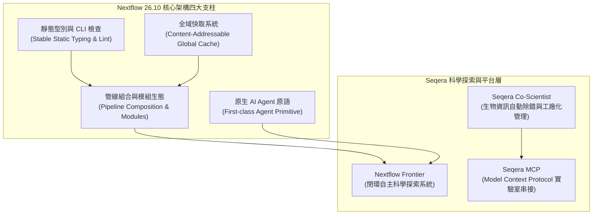
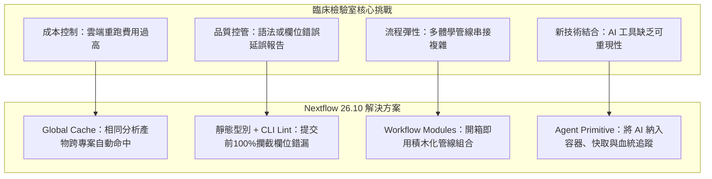

# Nextflow 最新功能與重大架構更新彙整報告 (2026 年秋季版)

> **彙整區間**：2026 年 8 月至 10 月（涵蓋 2026 年 10 月中旬剛落幕之 **Virtual Nextflow Summit 2026** 與 **Barcelona Nextflow Training & Hackathon**，以及年度旗艦版本 **Nextflow 26.10** 正式發布）。  
> **資料來源**：[Seqera 官方 Blog](https://seqera.io/blog/)、[Nextflow 官方 YouTube 頻道 (@Nextflow)](https://www.youtube.com/@Nextflow/videos)、[Nextflow Summit 2026 官方大會議程](https://summit.nextflow.io/2026/) 與 GitHub 官方發布日誌。

---

## 1. 總覽：Nextflow 生態系的重大範式轉變

在 2026 年 8 月至 10 月期間，Nextflow 社群與 Seqera 迎來了近年來最大規模的技術躍進。核心主軸由過去的「**確定性資料流（Dataflow）流程引擎**」全面擴展為具備「**靜態型別安全（Static Typing）**」、「**跨專案全域快取（Global Cache）**」與「**原生 AI Agent 整合（Agentic Nextflow）**」的次世代科學計算與探索平台。



---

## 2. Nextflow 26.10 核心語言與執行引擎重大更新

Nextflow 26.10 於 2026 年 10 月 Summit 期間隆重發布，代表了社群長達一年多語言現代化工程的集大成，解決了大規模生醫資料處理與多專案重用中的痛點。

### 2.1 靜態型別系統全面穩定（Stable Static Typing & CLI Type Checking）

過去 Nextflow 採用動態型別，欄位名稱拼錯或通道資料結構不合通常需等到任務執行數小時甚至排隊到雲端時才拋出例外。Nextflow 26.10 正式將靜態型別納入穩定支援：

* **核心機制**：
  * 支援在 `workflow`、`process`、`channel` 與自訂 `record` 定義明確的型別契約。
  * 支援具名型別結構（Record Types），徹底取代以往容易混淆的 `tuple val(meta), path(reads)` 自由組合。
  * 靜態檢查器可在本地端驗證資料流合約，確保上游 process 的輸出必定相容於下游 process 的輸入。
* **CLI 前置檢查工具**：
  * 推出 `nextflow lint` 指令，能在不啟動任何容器、不向 HPC/Cloud 派發任何任務的前提下，於數秒內對整個 pipeline 進行語法與型別相容性靜態驗證。
  * `nextflow run` 在初始化階段即進行型別檢查，及早攔截輸入錯誤。

```nextflow
// 範例：Nextflow 26.10 靜態型別與 Record 定義
nextflow.enable.types = true

record SampleMeta {
    String id
    String condition
    Boolean paired_end
}

record FastqPair {
    SampleMeta meta
    Path read1
    Path read2
}

process FASTQC {
    input:
    FastqPair sample

    output:
    tuple SampleMeta, Path, emit: qc_html

    script:
    """
    fastqc -q ${sample.read1} ${sample.read2}
    """
}
```

---

### 2.2 全域快取（Global Cache：超越傳統 `-resume`）

這是 Nextflow 26.10 最受企業與大型機構關注的功能之一，從根本改變了管線重複計算的生命週期。

* **傳統 `-resume` 的局限**：
  * 僅限於「同一個專案、同一個工作目錄（`work/`）、同一個工作流程實例」。
  * 當多位研究員在不同目錄執行相同參考基因體索引建構（如 STAR Index、BWA Index），或跑相同的對照組 QC 時，算力與儲存空間會被重複浪費數次。
* **Global Cache 工作原理**：
  * 採用**內容尋址雜湊（Content-Addressable Hashing）**：在計算 task hash 時剔除執行特定的隨機變數（如 Session ID、Process 內部名稱），純粹根據「輸入資料雜湊 + 執行腳本/指令 + 容器鏡像規格 + 軟體環境」計算簽章。
  * 支援雲端物件儲存後端（AWS S3、Google Cloud Storage、Azure Blob）及 Seqera Platform 統一管理。
* **效益**：
  * **Compute Once, Reuse Everywhere**：同機構或團隊內只要有人執行過該任務，其他人在不同流程只要使用相同的程式碼與輸入，Nextflow 便會自動自雲端快取拉取結果，不再重複耗費雲端 GPU/CPU 費用。

| 特性 | 傳統 `-resume` | Nextflow 26.10 Global Cache |
|---|---|---|
| **快取範圍** | 單一 pipeline、單一本地 `work/` 目錄 | 跨不同 pipelines、跨不同工作階段、跨專案目錄 |
| **雜湊計算依據** | Session ID + Process 名稱 + Task 屬性 | 嚴格 Content-Addressable（Inputs 內容 + 腳本指令） |
| **多使用者協同** | 不支援（無法安全跨使用者共用本地 work 目錄） | 支援（透過雲端物件儲存與權限控管共享） |
| **儲存成本** | 各專案重複堆疊中間產物 | 全域單一實體，杜絕重複冗餘資料 |

---

### 2.3 工作流程模組化（Workflow Modules）與原生管線組合（Pipeline Composition）

過往若要將多個獨立流程串接成大規模端到端（End-to-End）分析，開發者往往被迫撰寫複雜的 Shell 腳本、使用外部排程器（如 Airflow）或以非標準方式呼叫子流程。

* **Workflow Modules 發布與安裝**：
  * 模組化單元從單一 `process` 正式升級至整個 `workflow`。
  * 支援將獨立打包的子工作流程直接發布到官方 **Nextflow Registry**。
  * 支援**依賴隔離（Dependency Vendoring）**：當引入不同 workflow 模組時，各模組可宣告自身依賴的底層模組與相容版本，避免命名空間衝突。
* **原生管線組合（Pipeline Composition）**：
  * 透過 `workflow params` 與 `workflow outputs`，使整個 pipeline 具備嚴格的 API 介面。
  * 可直接在 Nextflow 中將多個 Pipeline 串接成 Meta-pipeline，享受統一的資料流追蹤、快取與日誌管理。

```nextflow
// 範例：從 Registry 引用整個 Workflow 模組並進行原生組合
include { RNASEQ_ALIGNMENT } from 'nf-core/rnaseq_alignment'
include { DIFFERENTIAL_EXPRESSION } from 'nf-core/differential_expression'

workflow {
    take:
        samplesheet_csv

    main:
        aligned_data = RNASEQ_ALIGNMENT(samplesheet_csv)
        results      = DIFFERENTIAL_EXPRESSION(aligned_data.counts, aligned_data.meta)

    emit:
        qc_summary = aligned_data.qc
        deseq_out  = results.tables
}
```

---

### 2.4 原生 AI Agent 原語（Agentic Nextflow：實驗性新特性）

在 2026 年 10 月 14 日，Nextflow 創辦人 Paolo Di Tommaso 發表了重量級專文《Making Agentic Data Analysis Reproducible and Scalable with Nextflow》，正式將 AI Agent 納入 Nextflow 一等公民（First-class citizen）。

* **誕生背景**：
  * 傳統生醫資訊管線是**確定性圖形（Deterministic DAG）**；而現代 AI 驅動的分析（如動態檢體異常診斷、文獻自動比對、動態質控決策）具備「自主推理、動態選擇工具、觀察中繼結果後動態調整下一步」的特性。
  * 若讓 AI Agent 在無法受控的 Python 腳本或黑箱環境中執行，將徹底摧毀生物資訊的核心基礎——「**可重現性（Reproducibility）**」與「**資料血統（Data Provenance）**」。
* **`agent` 語法與機制**：
  * 在 Nextflow DSL 中新增 `agent` 區塊，具備如 `process` 般的型別輸入、輸出合約。
  * 內部宣告使用的模型規格（model）、提示詞（prompt）、允許調用的工具（tools / skills）。
  * **完全繼承 Nextflow 引擎核心保證**：每一次 Agent 的推理、思考軌跡與工具呼叫產物均被視為標準 Task，具備獨立 `work/` 目錄、支援快取重現（`-resume`）、支援容器化隔離與完整的 Execution Trace 稽核。
* **執行外掛（Agent Runners）**：
  * `langchain4j` Runner：輕量級 JVM 直連模式，直接由 Nextflow Driver 呼叫相容於 OpenAI / Anthropic 的端點，無需容器開銷。
  * `pi` (`nf-agent-pi`) Runner：專為具備 Shell 操作能力與高度安全性隔離的 Agent 設計，於容器隔離環境內執行。
* **生態系 AI 技能（Agent Skills）**：
  * 推出官方 `migrate-nextflow-code` Skill，供程式碼助理（Claude Code、Cursor、Codex 等）使用，能自動化掃描舊版 Nextflow 程式碼，轉換為新版靜態型別與 Record 語法，並持續結合 `nextflow lint` 閉環修正直到無誤。

---

## 3. Seqera 官方平台與前沿生態創新（Blog 重要發布）

### 3.1 Nextflow Frontier：閉環自主科學探索系統（2026 年 10 月 13 日發布）

Seqera 執行長 Evan Floden 於峰會前夕發布了代號為 **Nextflow Frontier** 的自主探索架構：

* **核心定位**：針對生命科學中尚未解決的高難度問題（Unsolved biological challenges），設計一套能**自主提出科學假說、自動合成 Nextflow 管線程式碼、平行呼叫上千個雲端計算任務、驗證結果並反覆演進**的封閉迴路（Closed-loop Discovery System）。
* **BioML-bench 基準測試評測**：
  * Seqera 使用由史丹佛與業界主導的生醫機器學習基準套件 **BioML-bench**（包含 24 項跨領域挑戰）進行高強度驗證。
  * **整體成績**：超越榜單上 **92%** 的系統，平均成績比過往發表的最佳 AI 模型高出 **17 分**。
  * **領域細項**：
    * **藥物篩選（Drug Discovery）**：達到第 **96 百分位**（+29 分），成功展示 EGFR 小分子結合親和力的自動評分與篩選。
    * **單細胞體學（Single-Cell Omics）**：達到第 **96 百分位**（+8 分），完成多樣本、數萬顆腎臟細胞的動態聚類與註解。
    * **生物醫學影像（Biomedical Imaging）**：達到第 **76 百分位**（+30 分），預測肺部斷層掃描之功能退化趨勢。
    * **蛋白質工程（Protein Engineering）**：達到第 **94 百分位**，成功針對突變位點進行穩定性預測與排名。

---

### 3.2 Seqera Co-Scientist 與生物資訊自動化處理廠（2026 年 9～10 月）

* **全球執行量突破**：截至 2026 年 9 月，Nextflow 全球管線月執行量正式突破 **600 萬次**。
* **打造值得信賴的「Bioinformatics Factory」**：
  * 由 Seqera 產品經理 Lizzie Bolitho 發布專題，解析生醫團隊邁向 2030 年的管線自動化工廠架構。
  * **自動化錯誤分診（Automated Error Triaging）**：利用微調後的生醫 Agent 即時監控執行失敗的 Task，精準識別是「記憶體不足（OOM）」、「雲端 Spot 實例中斷」、「參考基因體格式不合」或是「演算法數值不收斂」，並自動調整 Nextflow 參數重試。
  * **落實安全護欄（Safety Guardrails）**：嚴格區隔生成性推論與確定性計算，禁止 AI 在未經審查下修改核心臨床資料。

---

### 3.3 高效能運算與儲存最佳化更新

* **RustQC（高效能生醫質控工具鏈整合）**：
  * 推出以 Rust 語言打造的高效能工具，將傳統 RNA-seq 常見的 15 個獨立 QC 步驟整合至單一高效能二進位程式，大幅減少 Nextflow 在 I/O 繁重步驟上的容器調度延遲與磁碟讀寫成本。
* **原生日誌檢視器（Native Log Viewers）**：
  * Nextflow CLI 與 VS Code 擴充套件於 2026 年中陸續整合原生圖形化日誌檢視介面，支援即時查看 Task DAG 狀態流動與資源使用曲線。
* **Seqera MCP（Model Context Protocol）**：
  * 支援透過 Anthropic 主導的 MCP 協議，將 Nextflow 執行管線無縫銜接至現代電子實驗紀錄簿（ELN）如 **Benchling**，實現研究紀錄與雲端生訊計算管線的雙向即時通訊。

---

## 4. Nextflow YouTube 頻道與 Summit 2026 大會議程精選

Nextflow 官方 YouTube 頻道（[@Nextflow](https://www.youtube.com/@Nextflow/videos)）於 10 月期間密集上傳並直播了 Nextflow Summit 2026（波士頓、線上峰會與巴塞隆納工作坊）之精選演講與技術培訓。

### 4.1 大會主題演講與技術演進精選

1. **Evan Floden (Seqera CEO) 主題演講**：
   * *題目*：《Orchestrating Discovery: An Agentic Platform for Science》
   * *重點*：闡述生物資訊從「手動腳本」→「DSL 工作流」→「AI 協同科學平台」的三代演進，並正式發布 Nextflow Frontier。
2. **Paolo Di Tommaso 主題報告**：
   * *題目*：《What's New in Nextflow》
   * *重點*：深入示範 Nextflow 26.10 的 Global Cache 實際省下的雲端成本數據，以及展示如何撰寫第一個 `agent` 原語 Task。
3. **Lorena Pantano (Dana-Farber Cancer Institute, DFCI)**：
   * *題目*：《A Lab-Scale Pipeline Factory: Using AI Agents and Skills to Accelerate Nextflow Development》
   * *重點*：分享哈佛癌症中心如何結合 Agent Skills 與 Nextflow 模組庫，在數天內自動化組裝、測試並發布符合臨床等級的新型突變偵測管線。
4. **Colby Ford (Tuple) & 業界專案**：
   * *題目*：《Building Multi-agentic Bioworkflows with Microsoft Foundry and Nextflow》
   * *重點*：展示如何在 Azure 上利用微軟 Foundry 框架與 Nextflow 建立多智慧體生物工作流。
5. **產業焦點論壇（Panel Discussion on Agentic Bioinformatics）**：
   * 由 Evan Floden（Seqera）、María Teresita Laguinge（ZS）、Steve Marshall（Flagship Pioneering）與 Esha Joshi 對談。
   * 探討主軸：生成式 AI 與生物資訊工程的邊界——AI 負責探索與提出候選方案，Nextflow 負責確保確定性、可重現性與資料稽核。

### 4.2 影音教材與 Podcast 系列

* **《Hello Nextflow 2026》全新系列教學**：
  * 官方全面重製入門指南影音（包含 Setup、Part 1: Hello World、Part 2: Hello Channels 等）。
  * 全系列教學均全面改採現代化 DSL2 最佳實踐，捨棄過時的 Channel 操縱模式，轉為強調資料型別與結構化輸出。
* **The Nextflow Podcast（2026 年最新集數）**：
  * *Episode 58: Writing Nextflow plugins in 2026*：深入探討社群如何利用 Java/Groovy 撰寫相容於 26.10 的自訂 Executor、Storage Provider 與 Agent Runner 外掛。

---

## 5. 臨床與生醫研究團隊之導入效益與決策評估

針對醫院核心實驗室、基因體定序中心與生醫運算團隊，本波 Nextflow 更新帶來的實務價值評估如下：



### 關鍵決策建議：

1. **升級時機**：建議常規生產環境可先建立測試分支（Staging Branch），使用 `nextflow lint` 掃描現有 `main.nf`，逐步導入 `record` 型別定義，以避免中斷既有日常臨床檢驗發報。
2. **快取治理**：若實驗室每月雲端運算帳單超過數千美元，強烈建議導入 Global Cache 配置，尤其針對大型參考基因體索引（GRCh38, T2T）與通用公眾對照資料集，可顯著縮減 30%～50% 之重複儲存與運算開支。
3. **AI 探索應用邊界**：在臨床環境中，嚴禁使用未納入版本控制與日誌追蹤的外部獨立 AI 腳本；應優先利用 Nextflow 的 `agent` 原語，將 AI 探索步驟固定於特定容器內，並將模型版本、Prompt 模板與溫度參數作為 Task 輸入以維持溯源能力（Audit Trail）。

---

## 6. 官方資源與延伸閱讀連結

* **官方發布與 Blog**：
  * [Seqera Blog 主頁](https://seqera.io/blog/)
  * [Nextflow 26.10: Global Cache, Stable Types, and More](https://seqera.io/blog/nextflow-26-10-release/)
  * [Introducing Nextflow Frontier](https://seqera.io/blog/introducing-nextflow-frontier/)
  * [Making Agentic Data Analysis Reproducible and Scalable with Nextflow](https://seqera.io/blog/making-agentic-data-analysis-reproducible-and-scalable-with-nextflow/)
  * [Building a Bioinformatics Factory You Can Trust with Seqera Co-Scientist](https://seqera.io/blog/building-a-bioinformatics-factory-with-seqera-co-scientist/)
* **影音與會議資料**：
  * [Nextflow 官方 YouTube 頻道](https://www.youtube.com/@Nextflow)
  * [Nextflow Summit 2026 官方大會議程與簡報](https://summit.nextflow.io/2026/)
  * [Hello Nextflow 2026 影音教學清單](https://www.youtube.com/@Nextflow/playlists)
* **社群規範與管線庫**：
  * [nf-core 官方網站](https://nf-co.re/)
