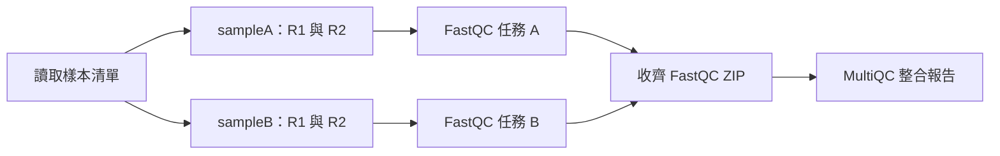

# 第八堂講義：從分析腳本到標準化流程——Nextflow 生物資訊工作流程入門

_高雄長庚臨床生物資訊系列課程｜講者：奇美醫院精準醫學核心實驗室組長邱家軍｜2026-11-03_

---

## 🎯 1. 本堂課要解決的問題

研究團隊收到一批 RNA-seq 定序資料，每個樣本有 R1、R2 兩個 FASTQ。先前分析人員逐一輸入指令，後來發現部分樣本未完成、不清楚使用哪個軟體版本，也不知道重跑是否會混入舊報告。本堂以這個情境，學習如何將分析整理成有輸入、有依賴關係、有執行紀錄的流程。

完成後，你應能閱讀簡單的 `process`、`channel`、`workflow`，執行 FastQC → MultiQC，區分分析成功與資料品質合格，並利用紀錄確認哪些樣本被執行、哪些任務被重用。課堂採講者操作與共同判讀；以下步驟也可供課後自行實作，不要求事先熟悉程式設計。

本講義與[實作目錄](../demos/nextflow-qc/)配套。測試檔完全為人工合成，不含病人資料；每個 FASTQ 僅四筆 reads，目的在驗證流程，不適合用來建立真實定序品質門檻。流程不包含比對、變異偵測或差異表現，也不是經臨床驗證的檢測流程。

### 1.1 為什麼一串指令還不夠？

Shell script 與 notebook 都可以寫得可重現，並不是天生不可靠；但當樣本增多，需要自己額外處理相依關係、平行運算、失敗恢復及版本紀錄。Nextflow 是工作流程管理工具，將這些機制整合進同一執行模型。它不會替你決定分析方法是否適當，也不會自動驗證生物學結論。[^1]

## 📚 2. 核心觀念：把分析理解成資料流

| 名稱 | 完整說明 | 本例對應 |
|---|---|---|
| Pipeline | 包含資料輸入、分析步驟、設定及輸出的整體流程 | 整個 QC 專案 |
| Process | 一個分析步驟的定義，宣告需要哪些輸入、執行什麼指令、應產生哪些檔案 | `FASTQC`、`MULTIQC` |
| Task | Process 在一組具體輸入上的一次執行 | `FASTQC(sampleA)` |
| Channel | 傳遞值或檔案參照的資料流，不是實體資料夾；下游在輸入可用時才能工作 | 每筆包含樣本 ID 與兩個 FASTQ |
| Workflow | 呼叫並串接 process 的程式區塊，描述資料的流向 | 先 FastQC，彙整後再 MultiQC |
| Parameter | 執行時可指定的流程參數 | `--input`、`--outdir` |
| Executor | 決定 task 交給哪裡執行的介面 | 本例為本機 `local`；其他可用 Slurm 等 |
| Container | 封裝工具及其使用者空間相依套件的映像檔 | FastQC、MultiQC 各使用固定 tag |

Process／workflow 的定義與執行環境可以分開：改用 HPC 時通常以設定改變 executor、資源與容器後端，但仍需確認資料路徑、權限及排程系統相容。[^1][^2]



兩個 FastQC task 可以獨立執行；是否同時執行，仍取決於可用 CPU、記憶體與排程。每個 task 處理一個樣本的兩個 read 檔，會產生兩份 HTML 與兩份 ZIP。因此兩個樣本的完整執行預期是 **2 個 FastQC task＋1 個 MultiQC task**，不是四個 FastQC task。

### 2.1 `work/` 與 `results/` 不同

Nextflow 為每個 task 建立工作目錄，放入輸入檔參照、實際指令、標準輸出、錯誤與產物，這個準備動作稱為 staging。`results/` 是另行發布給使用者閱讀的結果。下游應直接接上游輸出 channel，不應掃描尚未發布完成的 `results/` 來等待檔案。[^2]

## 🔧 3. 安裝與取得教材

### 3.1 版本與執行路線

本講義使用現有 DSL2 入門範例，維持非靜態型別的 process 語法以便逐步閱讀；新版型別功能在第 9 節介紹，不混入同一支程式。課程測試基準為 Nextflow **26.10.3**、FastQC **0.12.1**、MultiQC **1.30**。Java 建議使用 21 LTS；此版 Nextflow 需要相容的 Java 17 以上版本。[^3]

主要路線是 Nextflow＋Docker：Java 與 Nextflow 裝在主機，FastQC／MultiQC 在容器中執行，不需要另外安裝到主機。安裝軟體、下載映像檔前請確認醫院資訊政策與 Docker Desktop 授權條款。[^4]

### 3.2 Windows：使用 WSL2 Ubuntu

1. 在系統管理員 PowerShell 執行以下指令，依提示重新開機並建立 Ubuntu 帳號：

```powershell
wsl --install -d Ubuntu
wsl --list --verbose
```

2. 確認 Ubuntu 的 VERSION 為 2。安裝 Docker Desktop，選用 WSL2 backend，並在 Settings → Resources → WSL Integration 啟用 Ubuntu。日後以下 Linux 指令都在 **Ubuntu 終端機**執行，不是在 PowerShell。
3. 在 Ubuntu 安裝基礎工具：

```bash
sudo apt-get update
sudo apt-get install -y openjdk-21-jre-headless curl git unzip python3
java -version
docker info
```

建議把專案放在 WSL 的 Linux 使用者目錄，避免放在 `/mnt/c/` 的 Windows 同步資料夾。WSL 安裝與 Docker 整合仍需符合主機版本與機構權限。[^4][^5]

### 3.3 macOS

安裝 Docker Desktop 並啟動，確認使用 Linux containers；依 Apple Silicon 或 Intel 選擇正確安裝包。安裝 Temurin 21 JDK，若使用已安裝的 Homebrew，可執行：

```bash
brew install --cask temurin@21
brew install git python
java -version
docker info
```

Homebrew 尚未安裝者可由官方安裝頁設定，或直接使用 Temurin 官方安裝包。不要只因為電腦是 ARM，就任意更換未測試的工具版本；遇到映像架構不相容時，請參考第 8 節。[^6]

### 3.4 Linux（Ubuntu／Debian）

```bash
sudo apt-get update
sudo apt-get install -y openjdk-21-jre-headless curl git unzip python3
java -version
```

Docker Engine 請依 Docker 官方對應發行版指南安裝，然後用 `docker info` 確認服務及權限。不要為了繞過錯誤，對整個分析資料夾設定全員可寫權限；Docker 管理權限也需由資訊人員評估。[^7]

### 3.5 安裝固定版本 Nextflow

以下在 macOS、Linux 或 WSL Ubuntu 的 Bash／Zsh 中執行。先確認目前目錄沒有同名 `nextflow` 檔，避免覆寫既有檔案；若已有可用的 26.10.3，直接檢查版本即可。

```bash
mkdir -p course-tools
cd course-tools
curl -fsSL https://get.nextflow.io -o install-nextflow.sh
# 可先用文字編輯器檢閱下載的安裝程式，再執行。
NXF_VER=26.10.3 bash install-nextflow.sh
chmod +x nextflow
export PATH="$PWD:$PATH"
nextflow -version
cd ..
```

`export PATH` 只影響目前 shell；新終端機需重新設定或由資訊人員協助安裝到合適位置。Nextflow 安裝器與第一次啟動可能連網下載執行套件，不能只因已有 launcher 就假設能離線使用。[^3]

### 3.6 取得專案與預先下載容器

尚未下載本專案者執行：

```bash
git clone https://github.com/godkin1211/ClinicalBioinfoCourse.git
cd ClinicalBioinfoCourse/demos/nextflow-qc
```

已有專案者請進入自己的 `demos/nextflow-qc`，不要再次 clone 到同名目錄。以下所有實作指令均以這個目錄為起點。

```bash
pwd
ls main.nf nextflow.config data/samplesheet.csv
nextflow -version
docker info
docker pull quay.io/biocontainers/fastqc:0.12.1--hdfd78af_0
docker pull quay.io/biocontainers/multiqc:1.30--pyhdfd78af_0
docker run --rm quay.io/biocontainers/fastqc:0.12.1--hdfd78af_0 fastqc --version
docker run --rm quay.io/biocontainers/multiqc:1.30--pyhdfd78af_0 multiqc --version
```

兩個工具應分別回報 `FastQC v0.12.1` 與 MultiQC `1.30`。`--rm` 只移除該次檢查建立的暫時容器，不刪除 FASTQ、結果或映像檔。

## 📦 4. 測試輸入：樣本清單與 FASTQ

### 4.1 實際提供的檔案

```text
demos/nextflow-qc/
├── main.nf
├── nextflow.config
└── data/
    ├── samplesheet.csv
    ├── samplesheet-one.csv
    ├── samplesheet-missing.csv
    ├── sampleA_R1.fastq
    ├── sampleA_R2.fastq
    ├── sampleB_R1.fastq
    └── sampleB_R2.fastq
```

[完整樣本清單](../demos/nextflow-qc/data/samplesheet.csv)內容如下：

```csv
sample_id,fastq_1,fastq_2
sampleA,data/sampleA_R1.fastq,data/sampleA_R2.fastq
sampleB,data/sampleB_R1.fastq,data/sampleB_R2.fastq
```

`sample_id` 是追蹤標籤；`fastq_1`、`fastq_2` 指定檔案。本例的相對路徑以**啟動指令時的目錄**為基準，不是 CSV 所在目錄。流程也允許 `fastq_2` 留空，代表單端輸入；本課四個測試檔為雙端示意。

檔名需互不衝突，路徑與 ID 請使用英數字、底線、連字號及一般目錄分隔符，勿使用單引號或 shell 特殊字元。這個教學流程沒有完整的輸入安全與 schema 驗證，不應直接接收不可信任的外部清單。新增樣本時應使用新檔名；只複製一列並改 ID，不會變出新的生物學樣本。

### 4.2 FASTQ 四行代表什麼？

[sampleA R1](../demos/nextflow-qc/data/sampleA_R1.fastq)的第一筆為：

```text
@sampleA_read1/1
ACGTACGTACGTACGTACGTACGTACGTACGTACGTACGT
+
!IIIIIIIIIIIIIIIIIIIIIIIIIIIIIIIIIIIIIII
```

第一行是 read ID；第二行是讀到的序列；第三行以 `+` 分隔；第四行每個字元對應一個鹼基的品質值，長度須與序列一致。本例使用 Phred+33，`I` 對應 Q40；每個檔案第一筆的第一個品質字元刻意使用 `!`（Q0），讓 FastQC 可辨識編碼。若所有字元都是 `I`，FastQC 的自動判定可能將它當成舊式 Phred+64，讀成 Q9。品質值關係為 `Q = -10 log10(Perror)`，Q40 代表名義錯誤機率 0.0001，而不是保證每個鹼基都正確。

四個測試檔各有四筆、每筆 40 bases，合計 16 筆 read 紀錄；對雙端資料而言是 8 組 read pairs。R1／R2 在真實資料中來自同一片段兩端，不是額外的病人重複。這組人工序列不模擬真實片段插入長度或完整建庫過程。

```bash
wc -l data/sampleA_R1.fastq data/sampleA_R2.fastq data/sampleB_R1.fastq data/sampleB_R2.fastq
head -n 8 data/sampleA_R1.fastq
```

每個檔案預期 16 行。FastQC 不會確認 R1／R2 是否正確配對，也不會驗證病人身分；這些是其他檢查的責任。

## ⚙️ 5. 程式碼與設定逐步解讀

完整可執行程式見 [main.nf](../demos/nextflow-qc/main.nf)，設定見 [nextflow.config](../demos/nextflow-qc/nextflow.config)。請使用這兩個完整檔案執行；下列分段是閱讀教材，不是獨立 pipeline。

### 5.1 FastQC process：定義一次工作

```nextflow
process FASTQC {
    tag "${sample_id}"
    label 'fastqc'
    publishDir "${params.outdir}/fastqc", mode: 'copy'

    input:
    tuple val(sample_id), path(reads)

    output:
    path "*_fastqc.html", emit: html
    path "*_fastqc.zip", emit: zip

    script:
    def read_args = reads.collect { read -> "'${read}'" }.join(' ')
    """
    fastqc \
        --threads ${task.cpus} \
        --outdir . \
        ${read_args}
    """
}
```

`tag` 讓日誌顯示樣本名稱；`label` 把 task 分類，讓設定檔能集中指定 CPU、記憶體、容器。`tuple` 將同一樣本的 ID 與檔案一起傳遞，避免依靠任務完成順序配對。`val` 表示一般值，`path` 表示須進行 staging 的檔案；`reads` 在本例是兩個檔案的集合。[^2]

`output` 的 glob（萬用字元樣式）宣告預期產物，不是任意掃描整台電腦。`emit` 為輸出 channel 命名。`script` 產生真正執行的 shell 指令，`${task.cpus}` 取自資源設定。`--outdir .` 是 task 工作目錄，不是你啟動 Nextflow 的目錄；`publishDir` 之後再複製到使用者結果目錄。正式程式另有 `stub` 區塊，僅為結構示範產生占位檔，不執行 FastQC。[^2]

### 5.2 從 CSV 建立 channel

```nextflow
samples = channel
    .fromPath(params.input, checkIfExists: true)
    .splitCsv(header: true)
    .map { row ->
        def sample_id = row.sample_id?.trim()
        def fastq_1 = row.fastq_1?.trim()
        def fastq_2 = row.fastq_2?.trim()
        if (!sample_id) {
            error "samplesheet row is missing sample_id: ${row}"
        }
        if (!fastq_1) {
            error "sample ${sample_id} is missing fastq_1"
        }
        def reads = [file(fastq_1, checkIfExists: true)]
        if (fastq_2) {
            reads << file(fastq_2, checkIfExists: true)
        }
        tuple(sample_id, reads)
    }
```

`fromPath` 尋找清單，`splitCsv` 把每列轉成可依欄名存取的資料。`map` 把一列轉成 `(樣本 ID, FASTQ 清單)`；`trim` 去掉欄位前後空白，`?.` 避免欄位不存在時直接呼叫字串方法。`file(..., checkIfExists: true)` 檢查路徑存在，不會驗證 FASTQ 內部內容。[^8]

這裡的 `reads.collect { ... }` 是集合轉換，用來組 shell 參數；下一節的 channel `.collect()` 則是等待資料流完成。兩者名字相同，但層次不同。

### 5.3 為什麼 MultiQC 只執行一次？

```nextflow
FASTQC(samples)
fastqc_archives = FASTQC.out.zip
    .flatten()
    .collect()
MULTIQC(fastqc_archives)
```

每個 FastQC task 送出兩個 ZIP；`flatten()` 將集合攤平成個別檔案項目；channel `.collect()` 等待上游關閉、把所有項目收成一個清單，再讓 MultiQC 接收。因此它整合全批資料，而不是每個樣本各做一份報告。MultiQC 讀取 FastQC ZIP 內的 `fastqc_data.txt`，不是重新分析 FASTQ，也不是拿 HTML 圖片計算統計量。[^8][^9]

MULTIQC 的核心宣告如下：

```nextflow
input:
path fastqc_archives

output:
path 'multiqc_report.html', emit: report
path 'multiqc_data', emit: data

script:
"""
multiqc --force --outdir . ${fastqc_archives.join(' ')}
"""
```

此處沿用教學資料的簡單檔名。輸入若有重複 basename，staging 可能衝突；大型正式流程應以 metadata 與子目錄策略處理，不可直接去覆寫檔案。

### 5.4 設定檔為何與分析指令分開？

```groovy
params {
    input = 'data/samplesheet.csv'
    outdir = 'results'
}
process {
    executor = 'local'
    errorStrategy = 'terminate'
    withLabel: fastqc {
        cpus = 2
        memory = '2 GB'
        container = 'quay.io/biocontainers/fastqc:0.12.1--hdfd78af_0'
    }
    withLabel: multiqc {
        cpus = 1
        memory = '2 GB'
        container = 'quay.io/biocontainers/multiqc:1.30--pyhdfd78af_0'
    }
}
profiles {
    docker {
        docker.enabled = true
    }
}
```

設定片段展示資源與工具版本如何集中管理；完整設定還包含本機／Conda profile，以及 trace、report、timeline、DAG。`-profile docker` 是 Nextflow 選項，`--input`、`--outdir` 是流程參數，單破折號與雙破折號不能交換。`container` 只宣告映像檔，必須啟用對應後端才會使用；`standard` profile 需要主機 PATH 中已有真正的工具。

Container 不會固定所有外部因素，例如輸入、參考資料、Nextflow、host kernel。映像 tag 也不是不可變的身分證；正式分析應記錄 digest（內容識別碼），保存實際執行版本。

## ▶️ 6. 第一次執行與結果判讀

### 6.1 先檢查語法，再執行單樣本

確認位於 `demos/nextflow-qc`，且 Docker 正在執行：

```bash
nextflow lint .
nextflow run . -profile docker \
    --input data/samplesheet-one.csv \
    --outdir results/one
```

`lint` 應無語法錯誤；它不會證明工具能執行或資料正確。單樣本預期執行一個 FastQC task 與一個 MultiQC task，兩者完成後流程回報 `SUCCESS`。首次下載或容器啟動會增加時間，task hash、run name、完成先後順序每次可不同。

### 6.2 執行兩個樣本

```bash
nextflow run . -profile docker \
    --input data/samplesheet.csv \
    --outdir results/two
```

這次沒有 `-resume`，應建立三個新 task。主要預期輸出如下：

```text
results/two/
├── fastqc/
│   ├── sampleA_R1_fastqc.html
│   ├── sampleA_R1_fastqc.zip
│   ├── sampleA_R2_fastqc.html
│   ├── sampleA_R2_fastqc.zip
│   ├── sampleB_R1_fastqc.html
│   ├── sampleB_R1_fastqc.zip
│   ├── sampleB_R2_fastqc.html
│   └── sampleB_R2_fastqc.zip
├── multiqc/
│   ├── multiqc_report.html
│   └── multiqc_data/
│       ├── multiqc_general_stats.txt
│       └── ...其他統計與執行資料
└── pipeline_info/
    ├── execution_report.html
    ├── execution_timeline.html
    ├── execution_trace.txt
    └── pipeline_dag.html
```

樹狀圖列出應存在的主要產物，不限制 MultiQC 額外產生的檔案；統計欄位與報告內容會隨工具版本改變。報告不是 bit-for-bit 固定的測試答案，日期、路徑與時間等欄位可不同。可對照[精簡預期數值表](../demos/nextflow-qc/expected/fastqc_basic_stats.tsv)。MultiQC 1.30 的 general stats 將 reads 數以百萬為單位匯出，本例 `4e-06` 代表 4 reads。

```bash
ls results/two/fastqc
head -n 5 results/two/pipeline_info/execution_trace.txt
unzip -p results/two/fastqc/sampleA_R1_fastqc.zip \
    sampleA_R1_fastqc/fastqc_data.txt | head -n 18
python3 verify.py results/two --samples sampleA sampleB
```

驗證程式會確認檔案存在、ZIP 可讀、四個 FastQC 的每檔 reads 數及長度，並確認 MultiQC 確實彙整四個 read 檔。它不只是檢查 task 退出碼。預期最後顯示 `PASS`。

### 6.3 如何打開報告？

macOS：

```bash
open results/two/multiqc/multiqc_report.html
```

Linux 桌面：

```bash
xdg-open results/two/multiqc/multiqc_report.html
```

WSL Ubuntu：

```bash
explorer.exe .
```

再由檔案總管開啟 `results/two/multiqc/multiqc_report.html`。沒有圖形介面的伺服器可將報告複製到核准的工作站；不要為了開報告將院內資料上傳到公開網站。

### 6.4 讀報告時要問什麼？

| 要看什麼 | 它在回答的問題 | 本例預期與限制 |
|---|---|---|
| Basic statistics | 工具是否讀到正確的檔案、序列筆數與長度？ | 四個 read 檔各 4 reads、40 bases；不是四個病人 |
| Per base sequence quality | 各 cycle 的品質分布是否惡化？ | 第一個 cycle 的四個值為 Q0、Q40、Q40、Q40，平均 Q30；其餘 Q40，不能推論儀器狀態 |
| Sequence composition／GC | 鹼基組成是否有偏差？ | 人工重複序列會有非自然組成 |
| Duplication／overrepresented sequences | 是否有高度重複或過量序列？ | 小樣本中的單一序列占比很高，flag 不代表真實文庫不合格 |
| Adapter content | 是否有已知接頭訊號？ | 沒被標記不代表排除所有污染 |

FastQC 的 PASS／WARN／FAIL 是模組規則提示，不是臨床檢體合格證。MultiQC 可以幫助看批次中誰偏離，但不能替代檢體、文庫與下游分析的專業判斷。[^10]

## 🔄 7. 快取、接續執行與追溯

### 7.1 原樣重跑

緊接兩樣本執行之後，使用同一個目錄與 profile：

```bash
nextflow run . -profile docker \
    --input data/samplesheet.csv \
    --outdir results/two -resume
head -n 5 results/two/pipeline_info/execution_trace.txt
```

預期三個 task 都為 `CACHED`，表示重用先前產物，不是重新運算。`-resume` 選取先前 session，task hash 相符且預期工作產物仍在，才能命中。一般檔案快取預設會使用名稱、大小、修改時間等資訊，不應誤認為一律完整計算檔案內容雜湊。[^11]

### 7.2 從一樣本擴充到兩樣本

以下是一組獨立實驗，先建立新的單樣本執行，再立即接續：

```bash
nextflow run . -profile docker \
    --input data/samplesheet-one.csv --outdir results/grow-one
nextflow run . -profile docker \
    --input data/samplesheet.csv --outdir results/grow-two -resume
```

預期 sampleA FastQC 重用、sampleB FastQC 新執行、MultiQC 因收到的 ZIP 清單改變而重跑。本例 `--outdir` 只影響發布與執行報告，不是 FastQC 計算輸入，不能單靠換輸出目錄要求重新計算。若中間穿插其他 run，請以 `nextflow log` 查看 run name，使用 `-resume <run_name>` 明確指定 session。

### 7.3 哪些變更應該檢查是否重跑？

| 變更 | 本例預期 | 必須注意 |
|---|---|---|
| 原樣加 `-resume` | 重用完成任務 | 需保留 cache 與工作產物 |
| 加入新 FASTQ 樣本 | 新樣本 QC 與整合報告重跑 | 保留舊樣本的路徑、檔名及內容 |
| 修改 FastQC 指令或容器 | 受影響任務應重新評估 | 下游能否重用由 hash 與實際輸入決定 |
| 只更換發布目錄 | 計算可能仍重用 | 結果目錄不是 task cache |
| 刪除 `work/` 或 cache | 可能失去重用能力 | 不要在課堂實驗前清除 |

`-resume` 不會證明生物學正確，也不會保證「換參考基因體一定重跑」；參考檔必須真的成為相應 task 的輸入或其他可追蹤依賴。不要在執行中修改輸入檔，也不要把公開與受限制資料共用快取。[^11]

### 7.4 保留哪些證據？

`execution_trace.txt` 記錄 task 狀態、exit code 與資源資訊；`execution_report.html` 彙整執行概況；timeline 顯示任務時序；DAG 顯示相依關係。DAG 不是時間軸，節點相連也不代表每個樣本都已成功。

```bash
nextflow log
git rev-parse HEAD
docker image inspect quay.io/biocontainers/fastqc:0.12.1--hdfd78af_0 --format '{{json .RepoDigests}}'
docker image inspect quay.io/biocontainers/multiqc:1.30--pyhdfd78af_0 --format '{{json .RepoDigests}}'
```

保存命令、清單、資料 checksum、程式 commit、Nextflow／Java／容器身分、設定、QC 及人工判讀。設定檔可能含帳號或路徑，分享前應檢查；不可將密鑰寫入 repository。正式檢測仍需機構的驗證、版本變更與核發規範。

## 🔍 8. 故障練習與排查

### 8.1 不存在的 FASTQ

提供的 `samplesheet-missing.csv` 故意指向不存在檔案。使用獨立輸出目錄：

```bash
nextflow run . -profile docker \
    --input data/samplesheet-missing.csv --outdir results/missing
```

預期為非零退出碼，出現檔案不存在的訊息，不應產生有效 MultiQC 報告。本例缺檔是第一筆，因此尚未有 FastQC 工作；一般較大的清單可能已有其他樣本排程，不能保證所有輸入錯誤都在任何 task 啟動之前被發現。排查後以正確清單重跑即可，不要建立空 FASTQ 偽裝修好。

### 8.2 查 task 工作目錄

從 trace 的 hash 或錯誤訊息找到 task 的 `work/` 子目錄，以 `ls -a` 看隱藏檔：

| 檔案 | 用途 |
|---|---|
| `.command.sh` | 真正交給 shell 的工具指令 |
| `.command.run` | Nextflow 建立的執行／容器包裝腳本 |
| `.command.out` | 標準輸出 |
| `.command.err` | 標準錯誤；工具進度訊息也可能寫在這裡 |
| `.exitcode` | 程式退出碼；0 通常表示成功結束 |
| `.nextflow.log`（啟動目錄） | 流程層級的診斷資訊 |

不要直接修改已快取的工作產物來「修正」結果；應修改來源或設定，再受控重跑。

### 8.3 常見問題

| 現象 | 優先確認 | 處理方式 |
|---|---|---|
| `nextflow: command not found` | PATH 是否仍包含安裝目錄 | 重新設定 PATH 或使用 launcher 絕對路徑 |
| Java 版本錯誤 | `java -version` 與 `JAVA_HOME` | 切到相容的 JDK；不要只看已安裝清單 |
| Cannot connect to Docker daemon | Desktop／Engine 是否啟動 | 先讓 `docker info` 成功 |
| Permission denied | Docker socket 或輸入／輸出權限 | 請資訊人員協助，不要廣泛放寬權限 |
| `no matching manifest`／`exec format error` | 主機與容器 CPU 架構 | 使用核准的 x86_64 主機，或啟用並測試模擬環境 |
| Missing output file | 工具退出後是否真的產生宣告檔名 | 看 `.command.err` 與 `.command.sh`，不是先改 output 隱藏問題 |
| `CACHED` 比預期少 | session、輸入 metadata、指令、容器、work 是否改變 | 逐 task 對照，不要立即刪 cache |
| 流程成功但 QC 有 FAIL | 資料品質與執行狀態不同 | 解讀原始 QC，不能改成綠燈當作解決 |

ARM 主機若使用 x86_64 映像，需 Docker 的模擬支援；設定 `docker.runOptions = '--platform linux/amd64'` 之前先確認映像與主機能執行並評估效能。這不是對所有 ARM 系統的成功保證。

已有核准的本機工具可使用 `-profile standard`，或已設定 Conda 時使用 `-profile conda`。這些 profile 須另行驗證，不能把 Docker 測試成功視為其他環境也通過。沒有工具時可用 `-stub-run --outdir results/stub` 理解 channel／輸出契約，但產物只是占位檔，不能當 FastQC／MultiQC 分析結果，也不能拿來驗收實作。

## 🌐 9. Nextflow 新功能：用途、條件與邊界

本節以 [Nextflow_new_features.md](../Nextflow_new_features.md) 為議題清單，功能狀態以官方文件為準。主實作不依賴 Seqera Platform 帳號、雲端計費或 AI API，因此不會在上課時送出資料給外部模型。

### 9.1 靜態型別與 `nextflow lint`

型別是資料契約，例如某個輸入應為檔案 `Path` 而非任意文字。新版可在相應 `.nf` 啟用 `nextflow.enable.types = true`，搭配 typed process／workflow 檢查介面相容性。26.10 中靜態型別已離開 preview，但仍需在使用 typed 定義的腳本啟用；`nextflow lint` 會報告型別問題，`nextflow run` 的型別警告不等同強制阻擋執行。[^12]

型別檢查不會知道 sampleA 是否真的屬於某位病人，也不能證明 FASTQ 配對正確、方法適當或所有 shell 指令正確。「100% 攔截欄位錯漏」不是可接受的教學聲稱。將既有流程移轉 typed 語法時，應另建測試分支、逐步驗證，不可只加 feature flag 而保留所有舊式宣告。

### 9.2 Global Cache 與一般 `-resume`

一般 `-resume` 尋找選定既有 session 的 task cache；Global Cache 則讓相容的 task 在不同 run／pipeline 間共用內容尋址的產物。26.10 的 Global Cache 透過 Seqera Platform 提供，支援指定雲端儲存，不是本機加 `-resume` 就自動啟用。[^12]

評估重點包括存取控制、機敏資料隔離、結果保留、下載費用及哪些工作可共用。大型基因體索引可能適合共用，但不能預設所有流程必定降低固定百分比成本，更不能為追求命中率跳過必要重算。

### 9.3 模組化與 pipeline composition

Module 是可重用的流程元件；composition 是用明確輸入／輸出介面組合更大的流程。想像把 QC、比對、定量分成有版本的元件，而不是每個專案重新複製程式。新版提供 workflow modules 與 pipeline composition 的機制，但重用前仍需確認介面、版本、參考資料及驗證範圍。[^12]

nf-core 提供社群維護的 pipelines 與 modules；本例是教學程式，不是 nf-core 認證 pipeline。選用成熟流程仍需閱讀其輸入格式、參數、測試與限制，不能因名稱熟悉就當作院內臨床驗證完成。[^13]

### 9.4 Agentic Nextflow 與下一堂課

26.10 加入仍屬 preview 的 `agent` 元件，宣告輸入、提示詞、工具及輸出，將 agent 呼叫放進可追蹤的 task 模型。它可以協助摘要 QC 或提出排查建議，但不應自行排除樣本、修改檢測門檻或形成臨床診斷。[^14]

快取可以重播已保存的 agent 結果，不能保證重新呼叫非確定性的模型會得到相同答案。也不能假設平台一定提供模型內部完整思考過程。應保存可取得的模型識別、prompt、輸入、工具呼叫、輸出與人工修改，並確認資料外送政策。`pi` runner 使用容器，`langchain4j` 在 JVM 中執行，不能概括說所有 runner 都自動容器隔離。[^14]

本堂理解流程如何受控；第九堂再深入 agent／Skill 的操作與人工審核，不要求本堂先申請付費模型或提供 API key。

### 9.5 選配實作：MultiQC 的 Seqera AI 摘要

MultiQC 的 AI 摘要與 Nextflow 的 `agent` 元件不同：前者是 MultiQC 將 QC 統計送給模型做文字摘要，不需要在流程裡使用 `agent` 語法。範例另提供 `seqera_ai` profile，須明確選用才會送出資料；一般 Docker 示範不會自動呼叫 AI。[^15]

```bash
nextflow run . -profile seqera_ai \
    --seqera_token_file /absolute/path/to/seqera-token \
    --input data/samplesheet.csv \
    --outdir results/seqera-ai
python3 verify.py results/seqera-ai --samples sampleA sampleB --ai
```

token 放在 repository 外的純文字檔，使用自己的絕對路徑，不要把 token 值填入命令。設定只將此檔唯讀掛載給 MultiQC，由容器內讀取；不會把值插入 Nextflow 設定或 task 指令。AI 的 MultiQC 不使用快取，重跑可能再次消耗服務配額。

1.30 的預設 Seqera API 已不適用，因此此選配路線使用明確標示的相容入口，僅更新到官方新摘要路由。詳見[安裝與 API 相容性說明](../demos/nextflow-qc/README.md#選配seqera-ai-摘要)。原始 MultiQC 的 SUCCESS 不保證有摘要；相容入口與 `--ai` 驗證都會檢查摘要實際存在。即使功能成功，仍須人工核對數值、樣本、限制與建議，不讓 AI 自行排除樣本或設定臨床門檻。

## ✅ 10. 自我檢核與參考資料

### 10.1 完成標準

- [ ] 能說明兩個樣本為何產生三個 task、四組 FastQC 報告
- [ ] 真正執行 FastQC 與 MultiQC，並通過 `verify.py`，不是只有 stub
- [ ] 能在 MultiQC 找到四個 read 檔，解釋每檔 4 reads 的意義
- [ ] 原樣 `-resume` 後看到三個 `CACHED`
- [ ] 擴充樣本實驗中可辨識重用與新執行的 task
- [ ] 缺檔測試確實失敗，沒有將其解讀成「未發現問題」
- [ ] 知道型別、容器、快取與紀錄各自解決什麼，以及不能保證什麼

### 10.2 思考題與參考回答

**問：Nextflow 回報 SUCCESS，但 FastQC 出現 FAIL，是否矛盾？**

不矛盾。前者說執行成功並交付宣告產物；後者說某個品質指標觸發工具規則。要回到檢體、建庫與資料特性判斷，不能只看綠燈。

**問：為什麼不能讓 MultiQC 直接掃描舊的 results 資料夾？**

可能混入上一批報告，也可能在發布尚未完成時讀取不完整資料。用 channel 傳遞本次 FastQC ZIP，讓依賴關係與本次輸入明確。

**問：快取命中是否代表臨床結果已驗證？**

不是。它只是計算重用機制。適用檢體、事件類型、分析性能、結果審核與責任仍需獨立建立。

### 10.3 來源與實測紀錄

安裝與進階概念查核日：2026-11-03。實測結果與環境記錄見[驗證紀錄](../demos/nextflow-qc/VALIDATION.md)。Windows／Linux 安裝步驟依官方文件整理，不能宣稱已在每種作業系統逐一實測。所有預期 task 數與檔案數限定本課提供的測試清單。

[^1]: Nextflow 官方文件，Workflows。https://docs.seqera.io/nextflow/workflow
[^2]: Nextflow 官方文件，Processes。https://docs.seqera.io/nextflow/process
[^3]: Nextflow 官方文件，Installation。https://docs.seqera.io/nextflow/install
[^4]: Docker，Install Docker Desktop on Windows（含授權與 WSL 設定）。https://docs.docker.com/desktop/setup/install/windows-install/
[^5]: Microsoft，Install WSL。https://learn.microsoft.com/en-us/windows/wsl/install
[^6]: Eclipse Adoptium，Temurin installation；Docker macOS installation。https://adoptium.net/installation/ ；https://docs.docker.com/desktop/setup/install/mac-install/ ；https://brew.sh/
[^7]: Docker，Install Docker Engine on Ubuntu。https://docs.docker.com/engine/install/ubuntu/
[^8]: Nextflow，Operators（本例使用未啟用靜態型別的 DSL2 operators）。https://docs.seqera.io/nextflow/reference/operator
[^9]: MultiQC，FastQC module。https://docs.seqera.io/multiqc/modules/fastqc
[^10]: Babraham Bioinformatics，FastQC analysis modules。https://www.bioinformatics.babraham.ac.uk/projects/fastqc/Help/3%20Analysis%20Modules/
[^11]: Nextflow，Caching and resuming。https://docs.seqera.io/nextflow/cache-and-resume
[^12]: Nextflow，Migrating to 26.10。https://docs.seqera.io/nextflow/migrations/26-10
[^13]: nf-core，Pipelines。https://nf-co.re/pipelines
[^14]: Nextflow，Agents（preview；尤其 caching 與 containerization 章節）。https://docs.seqera.io/nextflow/agent
[^15]: MultiQC，AI summaries；服務會接收報告資料，並有憑證及人工審核要求。https://docs.seqera.io/multiqc/ai/
